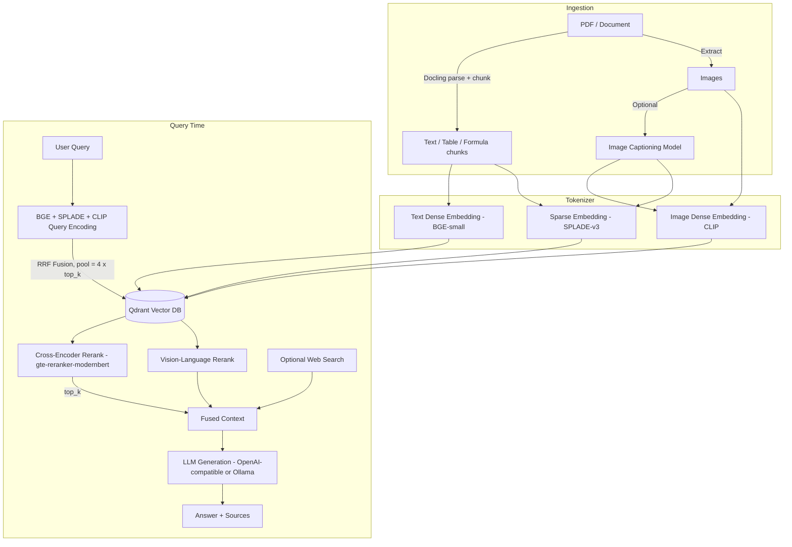

# Complete RAG — Hybrid Search, Image Captioning & Tree RAG

A locally-run, multimodal Retrieval-Augmented Generation (RAG) engine. It combines dense and sparse hybrid vector search, cross-encoder and vision-language reranking, optional image captioning, RAPTOR-style hierarchical summarization ("Tree RAG"), live web search augmentation, and bulk ingestion of Wikipedia or any Hugging Face dataset — all exposed through a FastAPI backend, a command-line interface, and a React web GUI.

All retrieval and reranking models run locally through Hugging Face `transformers` / `sentence-transformers`. Answer generation can be routed to any OpenAI-compatible endpoint (OpenAI, LM Studio, vLLM, MLX servers, etc.) or to a local model served through Ollama.

**Headline numbers** (BEIR, nDCG@10, full pipeline, Apple Silicon): SciFact **0.759**, FiQA **0.455**, ArguAna **0.489**, NFCorpus **0.341** — above the published BM25 baseline on all four. On SQuAD v1.1, the gold passage is ranked first for **91.5%** of questions. See [Benchmarks](#benchmarks).

## Table of Contents

- [Features](#features)
- [Architecture](#architecture)
- [Models Used](#models-used)
- [Tech Stack](#tech-stack)
- [Getting Started](#getting-started)
- [Usage](#usage)
- [CLI Reference](#cli-reference)
- [REST API Reference](#rest-api-reference)
- [Project Structure](#project-structure)
- [Configuration](#configuration)
- [Benchmarks](#benchmarks)
- [How was AI used for this project?](#how-was-ai-used-for-this-project)
- [License](#license)
- [References](#references)

## Features

- **Multimodal document ingestion** — PDFs (and other formats) are parsed with Docling, preserving text, tables, formulas (as LaTeX), and embedded images with page-level provenance.
- **Hybrid retrieval** — text chunks are indexed with a dedicated text embedder (BGE) and a learned sparse model (SPLADE-v3); the two result lists are fused with Qdrant's Reciprocal Rank Fusion (RRF), so both semantic and exact lexical matches contribute. Images and captions use CLIP, which keeps text-to-image search working.
- **Two-stage reranking** — the fused search fetches a candidate pool of 4 × `top_k` (capped at 100), and a long-context ModernBERT cross-encoder rescores it before the top `top_k` reach the LLM. A vision-language reranker rescores retrieved images against the query.
- **Optional image captioning** — pluggable captioners (Moondream2, BLIP, Florence-2, or LLaVA) generate captions that are embedded and indexed alongside each image, improving image retrievability.
- **Tree RAG** — an optional RAPTOR-inspired pipeline that clusters chunks with Gaussian Mixture Models, summarizes each cluster with the configured LLM, and recursively re-embeds the summaries into higher tree levels, so both fine-grained and holistic context are retrievable.
- **Web-augmented answers** — DuckDuckGo search plus Trafilatura content extraction can supplement or force-override local retrieval, with an optional self-correcting loop that rewrites the query or escalates to web search when an answer looks insufficient.
- **Bulk corpus ingestion** — multiprocess, streaming ingestion of the full Wikipedia dump or an arbitrary Hugging Face `datasets` dataset.
- **Three interfaces** — a Python CLI (`main.py`), a FastAPI HTTP/streaming API (`api.py`), and a React GUI (chat, ad-hoc query, and a Qdrant collection dashboard).
- **Swappable collections** — multiple named Qdrant collections can be created and switched between at runtime.
- **Benchmark suite** — `benchmark/` measures every retrieval stage on BEIR and the full question-answering pipeline on SQuAD, with per-query logs for failure analysis.

## Architecture



**Search flow.** For a text query, `VectorDatabase.Search()` runs the BGE query (with BGE's retrieval instruction prefix) and the SPLADE query against the text vectors, takes `top_k × RERANK_MULTIPLIER` candidates from each (capped at `RERANK_MAX_CANDIDATES`), and fuses them with Qdrant RRF. The cross-encoder then scores every unique candidate; its score sets the final order, and the RRF score is only used to break ties. The best `top_k` are returned. Image results are fused separately (CLIP text-to-image plus caption matches) and passed to the vision-language reranker.

If **Tree RAG** is enabled at ingestion time, leaf chunks are additionally clustered (Gaussian Mixture Models), summarized by the LLM, and re-embedded as parent nodes — recursively, up to a configurable depth — with every level stored in and retrievable from the same Qdrant collection.

## Models Used

The `Tokenizer` class (`backend/Tokenizer.py`) wraps every embedding, sparse-retrieval, reranking, and captioning model used by the pipeline. All defaults are Hugging Face model IDs and can be overridden via the CLI, the `/config/tokenizer` API endpoint, or the GUI's "Embedding & Caption Models" dialog.

| Role | Default model | Size | Library |
|---|---|---|---|
| Text dense embedding | `BAAI/bge-small-en-v1.5` | 33M params, 384-dim | `sentence-transformers` |
| Image + caption dense embedding | `clip-ViT-B-32` | 512-dim | `sentence-transformers` |
| Sparse lexical embedding | `naver/splade-v3` | vocabulary-sized sparse vector | `transformers` |
| Text cross-encoder reranker | `Alibaba-NLP/gte-reranker-modernbert-base` | 149M params, 8192-token context | `sentence-transformers` |
| Vision-language reranker | `nvidia/llama-nemotron-rerank-vl-1b-v2` | 1B params | `transformers` |
| Image captioner (optional, user-selectable) | `vikhyatk/moondream2`, `Salesforce/blip-image-captioning-base`, `microsoft/Florence-2-large`, or `llava-hf/llava-1.5-7b-hf` | — | `transformers` |
| Answer generation | Any OpenAI-compatible chat model, or a local model served via Ollama | — | `openai` / REST |

**Text dense embedding — BGE.** `BAAI/bge-small-en-v1.5` embeds text chunks into the `text_dense` vector. Queries get BGE's retrieval instruction ("Represent this sentence for searching relevant passages: "); documents get no prefix. BGE comes from the C-Pack work by Xiao et al. [1]. `BAAI/bge-base-en-v1.5` (768-dim) can be swapped in with `--text_dense_model`; on SciFact it scored +0.006 nDCG@10 (within noise) and ingested about 30% slower (see [Ablations](#ablations-scifact-full-mode)). Setting `--text_dense_model None` gives SPLADE-only text retrieval.

**Image dense embedding — CLIP.** `clip-ViT-B-32`, loaded through `sentence-transformers`, embeds document images and their captions into a shared 512-dimensional space, which is what makes text-to-image and image-to-text retrieval possible. CLIP was introduced by Radford et al. [2]; the `sentence-transformers` library used to load it is described by Reimers and Gurevych [3]. CLIP is no longer used for text chunks: its text encoder truncates at 77 tokens and was not trained for passage retrieval, and on its own it scored only 0.038 nDCG@10 on FiQA and 0.198 on SciFact.

**Sparse embedding — SPLADE-v3.** `naver/splade-v3` produces a sparse, vocabulary-sized vector via log-saturated ReLU activations over masked-language-model logits, giving the system exact keyword and term-expansion matching to complement the dense embedder. SPLADE-v3 is described by Lassance et al. [4].

**Cross-encoder reranker — gte-reranker-modernbert-base.** `Alibaba-NLP/gte-reranker-modernbert-base` jointly encodes the query and each candidate passage (or image caption) to produce a relevance score, and is used as the second-stage reranker over the fused hybrid candidates. It is a reranker from Alibaba's GTE family [5], built on the ModernBERT encoder [6], with an 8192-token context, so 1200-character chunks are never truncated. It requires `transformers >= 4.48`. It replaced `cross-encoder/ms-marco-MiniLM-L-12-v2` (a MiniLM [7] model trained on MS MARCO [8]), which added little over hybrid retrieval in this pipeline (see [Reranker comparison](#reranker-comparison)).

**Vision-language reranker.** `nvidia/llama-nemotron-rerank-vl-1b-v2` is a multimodal cross-encoder that scores a query directly against a document image (and its caption), and is used specifically to rerank retrieved page images [9]. Pass `--vision_rerank_model None` to skip loading it on text-only corpora.

**Image captioning (optional).** When enabled, one of four captioners generates a text caption for every extracted image, which is then embedded (dense + sparse) so images become retrievable by text query even without a caption match at reranking time:
- **Moondream2** — a small, open-weight vision-language model [10].
- **BLIP** (`Salesforce/blip-image-captioning-base`) — bootstrapped vision-language pretraining for captioning [11].
- **Florence-2** (`microsoft/Florence-2-large`) — a unified, prompt-based vision foundation model [12].
- **LLaVA** (`llava-hf/llava-1.5-7b-hf`) — a visual instruction-tuned multimodal model [13].

**Tree RAG clustering.** Cluster assignment over chunk/summary embeddings uses Gaussian Mixture Models from scikit-learn [15], following the recursive embed–cluster–summarize approach introduced by RAPTOR [14].

**Hybrid fusion.** Dense and sparse result lists are combined using Reciprocal Rank Fusion, the method of Cormack, Clarke, and Buettcher [16], via Qdrant's native `FusionQuery` [17].

**Generation LLM.** The generation step is provider-agnostic: `OpenAILLM` talks to any OpenAI-compatible `/v1/chat/completions` endpoint (OpenAI's own API [25], or a self-hosted OpenAI-compatible server such as LM Studio, vLLM or an MLX server), and `OllamaLLM` talks to a local Ollama server [26]. No specific generation model is hard-coded — the model string is passed in at configuration time.

## Tech Stack

**Backend (Python, `backend/`)**
- FastAPI + Uvicorn — HTTP API and streaming (SSE) chat endpoint [23]
- PyTorch, Hugging Face `transformers`, `sentence-transformers` — model loading and inference (CUDA, Apple MPS or CPU)
- Qdrant Client — vector database access, hybrid queries, RRF fusion [17]
- Docling — PDF/document parsing, layout-aware chunking, table and formula extraction, with EasyOCR for scanned pages [18]
- LangChain Text Splitters (`RecursiveCharacterTextSplitter`) — chunking [19]
- Hugging Face `datasets` — streaming ingestion of Wikipedia [20] and arbitrary HF datasets
- `ddgs` — DuckDuckGo search [22]
- Trafilatura — clean text extraction from fetched web pages [21]
- scikit-learn — Gaussian Mixture Models for Tree RAG clustering [15]
- `openai` Python SDK — OpenAI-compatible chat completions

**Frontend (`frontend/`)**
- React 19 + Vite [24]
- Ant Design and Radix UI / shadcn-style primitives for the component library
- React Router, Recharts, Tailwind CSS

**Infrastructure**
- Qdrant — vector database (run locally, typically via Docker) [17]
- Ollama (optional) — local LLM serving [26]

## Getting Started

### Prerequisites

- Python 3.11 or later
- Node.js 18 or later
- Docker (recommended, for running Qdrant)
- A CUDA GPU or Apple Silicon (MPS) is recommended for the embedding, reranking, and captioning models; CPU also works but is slower
- An OpenAI-compatible API key or local OpenAI-compatible server, **or** a running Ollama instance, for answer generation

### 1. Start Qdrant

```bash
docker run -p 6333:6333 -p 6334:6334 qdrant/qdrant
```

### 2. Backend setup

```bash
git clone https://github.com/Vans1000/Complete-Rag.git
cd Complete-Rag/backend

python -m venv .venv
source .venv/bin/activate   # Windows: .venv\Scripts\activate

pip install torch pillow numpy scikit-learn \
            "transformers>=4.48" sentence-transformers \
            qdrant-client \
            docling docling-core \
            langchain-text-splitters \
            datasets \
            ddgs aiohttp trafilatura httpx \
            openai requests \
            fastapi uvicorn pydantic python-multipart
```

`transformers` 4.48 or newer is required by the ModernBERT-based reranker. Models are downloaded from Hugging Face on first use.

### 3. Frontend setup

```bash
cd ../frontend
npm install
```

The Vite dev server proxies `/config`, `/ingest`, `/chat`, `/collections`, `/dashboard`, and `/health` requests to `http://127.0.0.1:8000`, so the backend must be running on port 8000 (the default) for the GUI to work.

## Usage

### Run the full stack (API + GUI)

```bash
# Terminal 1 — backend API
cd backend
python main.py --api --collection_name my_collection

# Terminal 2 — frontend
cd frontend
npm run dev
```

Open the printed Vite URL (default `http://localhost:5173`). From the GUI you can configure the LLM provider and tokenizer models (including the text embedding model), create/switch Qdrant collections, upload documents (optionally with Tree RAG enabled), import a Hugging Face dataset, chat with the corpus, and inspect indexed points on the dashboard page.

### CLI: ingest a document and ask a question

```bash
python main.py \
  --collection_name my_collection \
  --documents ./papers/example.pdf \
  --llm_provider openai --llm_model gpt-4o-mini \
  --ask "What does the document say about X?"
```

### CLI: interactive chat

```bash
python main.py --collection_name my_collection --llm_provider ollama --llm_model llama3.1 --chat
```

Inside chat mode: `/web` toggles web-augmented retrieval, `/forceweb` forces every answer to prioritize live web results, `/clear` resets history, `/exit` quits.

### CLI: ingest Wikipedia or a Hugging Face dataset

```bash
# Full English Wikipedia (streamed, multiprocess)
python main.py --collection_name wiki --wikipedia --workers 4

# Any Hugging Face dataset
python main.py --collection_name my_dataset \
  --huggingface_dataset squad --hf_text_col context --workers 4
```

## CLI Reference

Selected flags from `backend/main.py` (`python main.py --help` for the full list):

| Flag | Description |
|---|---|
| `--collection_name` (required) | Qdrant collection to read/write |
| `--documents`, `--document_dir` | File(s) or directory to ingest |
| `--tree_rag` | Enable hierarchical Tree RAG ingestion |
| `--text_dense_model` | Dense embedder for text chunks (default `BAAI/bge-small-en-v1.5`; `None` = SPLADE-only text retrieval) |
| `--dense_model` | CLIP model for images, captions and image search (default `clip-ViT-B-32`) |
| `--sparse_model`, `--cross_encoder_model`, `--vision_rerank_model`, `--caption_model` | Override any other tokenizer model; `None` skips the vision reranker or captioner |
| `--rerank_multiplier` | Candidate pool = `top_k ×` this value before cross-encoder reranking (default 4) |
| `--wikipedia` | Ingest the full Wikipedia dataset |
| `--huggingface_dataset`, `--hf_subset`, `--hf_split`, `--hf_text_col`, `--hf_id_col` | Ingest an arbitrary HF dataset |
| `--batch_size`, `--workers` | Tune bulk ingestion throughput |
| `--chat` | Start interactive CLI chat |
| `--ask` | Ask a single question non-interactively |
| `--llm_provider` | `openai` or `ollama` |
| `--llm_model`, `--llm_base_url` | Model name / endpoint override (include `/v1` for OpenAI-compatible servers) |
| `--use_web`, `--force_web`, `--ingest_web` | Web search augmentation controls |
| `--self_correction` | Enable the query-rewrite / web-escalation retry loop |
| `--api`, `--api_host`, `--api_port` | Start the FastAPI server instead of CLI mode |

## REST API Reference

Selected endpoints from `backend/api.py` (served at `http://localhost:8000` by default):

| Method & Path | Purpose |
|---|---|
| `POST /config/llm` | Configure the LLM provider/model |
| `POST /config/tokenizer` | Reconfigure embedding/reranking/captioning models (including `text_dense_model`) |
| `POST /config/websearch` | Configure web search result count |
| `POST /config/tree_rag` | Enable/disable Tree RAG for future ingests |
| `POST /ingest/file` | Upload and index a document (background task) |
| `GET /ingest/progress/{upload_id}` | Poll ingestion progress |
| `POST /ingest/web` | Ingest a URL or web search results |
| `POST /ingest/huggingface` | Bulk-ingest a Hugging Face dataset |
| `POST /query` | Hybrid vector search only, no LLM generation |
| `POST /chat` | RAG chat (non-streaming) |
| `POST /chat/stream` | RAG chat (Server-Sent Events streaming) |
| `GET /collections` / `POST /collections` / `POST /collections/switch` | Manage Qdrant collections |
| `GET /dashboard/stats` / `POST /dashboard/points` | Collection statistics and point browsing |
| `GET /health` | Service health check |

## Project Structure

```
Complete-Rag/
├── backend/
│   ├── main.py                # CLI entry point
│   ├── api.py                 # FastAPI application
│   ├── rag_config.py          # Shared retrieval defaults: text embedder, chunking, rerank pool
│   ├── Tokenizer.py           # Dense/sparse embedding, reranking, captioning
│   ├── VectorDatabase.py      # Qdrant collection + hybrid search + reranking
│   ├── File.py                # Docling-based document parsing & ingestion
│   ├── TreeRag.py             # RAPTOR-style hierarchical summarization
│   ├── LLM.py                 # OpenAI-compatible / Ollama LLM clients + RAG chat loop
│   ├── WebSearch.py           # DuckDuckGo search + web content ingestion
│   ├── Wikipedia.py           # Streaming Wikipedia ingestion
│   └── HuggingFaceDataset.py  # Streaming ingestion of arbitrary HF datasets
├── benchmark/
│   ├── bench_retrieval.py     # BEIR retrieval benchmark, one row per pipeline stage
│   ├── bench_e2e.py           # End-to-end QA benchmark (SQuAD or your own JSONL)
│   ├── common.py              # Model loading, collection naming, resumable ingestion
│   ├── metrics.py             # nDCG, MRR, recall, precision, token F1, exact match
│   ├── test_metrics.py        # Unit checks for the metrics
│   └── results/               # JSON, Markdown and per-query JSONL outputs
└── frontend/
    └── src/
        ├── pages/             # ChatPage, QueryPage, DashboardPage
        ├── components/        # NavBar, LLM/Tokenizer config modals, collection selector, etc.
        └── context/           # Shared app state (AppContext)
```

## Configuration

- **LLM provider**: set via `--llm_provider`/`--llm_model` on the CLI, `POST /config/llm`, or the GUI's LLM dialog. `openai` mode accepts any OpenAI-compatible `base_url` (OpenAI itself, LM Studio, vLLM, MLX servers, etc.); `ollama` mode talks to a local Ollama server.
- **Embedding/reranking/captioning models**: set via CLI flags, `POST /config/tokenizer`, or the GUI's "Embedding & Caption Models" dialog. Changing these reloads the corresponding models into memory; previously indexed vectors in Qdrant are unaffected.
- **Retrieval defaults** live in `backend/rag_config.py` and are shared by ingestion, search and the benchmarks:

  | Setting | Default | Meaning |
  |---|---|---|
  | `TEXT_DENSE_MODEL` | `BAAI/bge-small-en-v1.5` | Text chunk embedder (`"None"` = SPLADE-only text retrieval) |
  | `CHUNK_SIZE` / `CHUNK_OVERLAP` | 1200 / 200 characters | Chunking for Wikipedia, HF datasets and web pages (~250–300 tokens, inside every model's 512-token window). PDF chunking in `File.py` uses 1200 / 350. |
  | `RERANK_MULTIPLIER` | 4 | Candidates fetched per source = `top_k × 4` |
  | `RERANK_MAX_CANDIDATES` | 100 | Upper bound on the rerank pool |

  Lowering `RERANK_MULTIPLIER` to 2 roughly halves search latency for a small quality loss (see [Rerank pool size](#rerank-pool-size-fiqa-full-mode)).
- **Changing the text embedder needs a new collection.** The `text_dense` vector size is fixed when a collection is created (384 for BGE-small, 768 for BGE-base). If a collection's `text_dense` size doesn't match the loaded embedder — for example a collection created before this change, when CLIP's 512-dim vectors were used for text — search prints a warning and falls back to SPLADE-only for text. Create a new collection and re-ingest to get hybrid search back.
- **Collections**: multiple Qdrant collections can be created and switched between without restarting the backend.

## Benchmarks

All numbers below were measured on an Apple Silicon Mac (MPS backend, macOS arm64, Python 3.11.15, PyTorch 2.11.0) with the default configuration: BGE-small text embedder, SPLADE-v3, 1200/200-character chunks, `gte-reranker-modernbert-base`, `top_k = 10` and a rerank pool of 40 (4 × `top_k`). The vision reranker was not loaded, since the benchmark corpora are text-only.

### What gets measured?

| Script | Question it answers | Data |
|---|---|---|
| `bench_retrieval.py` | How good is each retrieval stage, and what does each one cost? | BEIR [27]: SciFact [28], FiQA-2018 [29], NFCorpus [30], ArguAna [31] (test splits) |
| `bench_e2e.py` | Does the full pipeline produce correct answers, and how fast? | SQuAD v1.1 validation [32], or your own JSONL QA set |
| `test_metrics.py` | Are the metric implementations correct? | built-in cases |

| Dataset | Domain | Documents | Queries evaluated | Chunks indexed |
|---|---|---|---|---|
| SciFact | Scientific claim verification | 5,183 | 300 (all) | 12,142 |
| FiQA-2018 | Financial opinion QA | 57,638 | 300 (sampled, seed 0) | — |
| NFCorpus | Nutrition / medical | 3,633 | 323 (all) | 9,435 |
| ArguAna | Counter-argument retrieval | 8,674 | 300 (sampled, seed 0) | 12,206 |
| SQuAD v1.1 | Wikipedia reading comprehension | validation contexts | 200 questions (sampled, seed 0) | — |

Documents are chunked exactly as the app chunks them, and chunk hits are mapped back to their source document before scoring.

**Retrieval ablation modes** (each one is a stage of `VectorDatabase.Search`):

- `dense`: text embedder (`text_dense`, BGE-small) only
- `sparse`: SPLADE-v3 (`text_sparse`) only
- `hybrid`: dense + sparse with Qdrant RRF, no reranking
- `full`: `VectorDatabase.Search()` exactly as the app calls it (RRF over a 4 × `top_k` pool, then cross-encoder rerank)
- `sparse_ce`: SPLADE only, then the same cross-encoder rerank (shows what the dense embedder adds once a reranker is present)

Metrics: nDCG@10 (the standard BEIR headline number), MRR@10, P@5, Recall@5/10, p50/p95 latency, QPS, plus ingestion throughput (chunks/s, split into embedding vs Qdrant upload time). Differences between configurations are reported with 95% paired bootstrap confidence intervals over queries, computed from the `*_per_query.jsonl` files.

**End-to-end metrics:**
- `gold_hit@1`, `gold_hit@k`: was the gold passage retrieved?
- `answer_in_context`: does the context sent to the LLM contain the answer?
- `answer_contains`: does the LLM's response contain a gold answer? (the main accuracy number for verbose generative answers)
- `llm_judge_acc`: with `--judge`
- `token_f1` / `exact_match`: shown for reference; they're low by design because the system prompt asks for long, cited answers
- `abstention_rate`: same failure phrases `RAGChat._evaluate_answer` uses
- `empty_response_rate`: replies with no content (e.g. a reasoning model running out of tokens)
- Latency split into retrieval / generation / total

### Setup

```bash
docker run -p 6333:6333 qdrant/qdrant          # if not already running
cd backend && source .venv/bin/activate         # the project's env already has every dependency
cd ..
python benchmark/test_metrics.py                # quick sanity check
```

### Run

These are the commands that produced the results below (run from the repository root):

```bash
# Main retrieval results (all five modes)
python benchmark/bench_retrieval.py --dataset scifact  --top_k 10
python benchmark/bench_retrieval.py --dataset nfcorpus --top_k 10
python benchmark/bench_retrieval.py --dataset fiqa     --top_k 10 --max_queries 300
python benchmark/bench_retrieval.py --dataset arguana  --top_k 10 --max_queries 300

# Rerank pool size sweep (pool = top_k x multiplier)
for m in 1 2 4; do
  python benchmark/bench_retrieval.py --dataset fiqa --top_k 10 --max_queries 300 \
    --modes hybrid full --rerank_multiplier $m
done

# Configuration ablations on SciFact
python benchmark/bench_retrieval.py --dataset scifact --top_k 10 --text_dense_model None --modes sparse full sparse_ce
python benchmark/bench_retrieval.py --dataset scifact --top_k 10 --text_dense_model BAAI/bge-base-en-v1.5
python benchmark/bench_retrieval.py --dataset scifact --top_k 10 --chunk_size 800 --chunk_overlap 150

# End-to-end on SQuAD with a local OpenAI-compatible server (top_k 5 and 10)
python benchmark/bench_e2e.py --llm_provider openai --llm_base_url http://localhost:8000/v1 \
  --llm_model maple-preview-2bit-mlx --n 200 --judge --top_k 5
python benchmark/bench_e2e.py --llm_provider openai --llm_base_url http://localhost:8000/v1 \
  --llm_model maple-preview-2bit-mlx --n 200 --judge --top_k 10

# Other providers
OPENAI_API_KEY=... python benchmark/bench_e2e.py --llm_provider openai --llm_model gpt-4o-mini --n 200 --judge
python benchmark/bench_e2e.py --llm_provider ollama --llm_model llama3.1 --n 100

# Your own documents: ingest with main.py as usual, then
python benchmark/bench_e2e.py --qa_file my_qa.jsonl --collection my_collection ...
#   my_qa.jsonl lines: {"question": "...", "answers": ["..."], "gold_doc": "<file name or source_id, optional>"}
```

In zsh, write flags inline as above; a flag list stored in a shell variable needs `${=VAR}` to be split into words.

Every run writes `benchmark/results/*.json` (full report), `*.md` (table), and `*_per_query.jsonl` / `*_per_question.jsonl` (for digging into failures). Each corpus goes into its own collection, named `bench_<dataset>_<text embedder>_c<chunk size>`, so changing the embedder or chunk size creates a new collection automatically. Ingestion is resumable: an interrupted run continues where it stopped. Pass `--reingest` to rebuild a collection from scratch.

Useful flags:
- `--load_vision`: also loads the 1B vision reranker. It's off by default because text-only corpora never call it.
- `--text_dense_model`, `--dense_model`, `--sparse_model`, `--cross_encoder_model`: compare swapped-in models.
- `--chunk_size`, `--chunk_overlap`, `--rerank_multiplier`: compare retrieval settings.
- `--temperature`: generation runs at 0 for reproducibility; the app's default is 0.7.
- `--judge_provider`, `--judge_model`, `--judge_base_url`: use a different (ideally stronger) model as the judge.

### Results: retrieval (nDCG@10)

| Dataset | dense | sparse | hybrid | **full** | sparse_ce | full − hybrid (95% CI) | BM25 [27] |
|---|---|---|---|---|---|---|---|
| SciFact | 0.702 | 0.711 | 0.728 | **0.759** | 0.746 | +0.031 [+0.004, +0.057] | 0.665 |
| FiQA-2018 | 0.381 | 0.354 | 0.396 | **0.455** | 0.391 | +0.059 [+0.038, +0.080] | 0.236 |
| NFCorpus | 0.323 | 0.340 | **0.343** | 0.341 | 0.340 | −0.001 (not significant) | 0.325 |
| ArguAna | 0.428 | 0.383 | 0.425 | **0.489** | 0.428 | +0.064 [+0.042, +0.086] | 0.315 |

Full-mode detail:

| Dataset | MRR@10 | Recall@10 (hybrid → full) | full p50 / p95 ms | hybrid p50 ms |
|---|---|---|---|---|
| SciFact | 0.736 | 0.836 → 0.853 | 745 / 988 | 34 |
| FiQA-2018 | 0.538 | 0.456 → 0.520 | 781 / 924 | 34 |
| NFCorpus | 0.574 | 0.162 → 0.161 | 790 / 972 | 33 |
| ArguAna | 0.347 | 0.840 → 0.920 | 1470 / 2432 | 43 |

What the numbers say:
- **The reranker gives significant gains on three of four datasets** (+0.03 to +0.06 nDCG@10). Because it reranks a pool four times larger than `top_k`, it also raises recall: on ArguAna the number of queries with no relevant document in the top 10 halves, from 48 to 24.
- **NFCorpus doesn't move.** Its queries have many relevant documents each (Recall@10 is only ~0.16), so the score is limited by how many relevant documents reach the pool rather than by their order.
- **Keep the dense embedder even with a reranker.** `full` beats `sparse_ce` by +0.064 on FiQA and +0.061 on ArguAna: BGE brings candidates that SPLADE misses.
- **Cost:** hybrid search takes ~33 ms; the cross-encoder brings it to ~750–830 ms per query at pool 40 (ArguAna is slower because its queries are whole arguments).
- **Comparison to published numbers:** the full pipeline is above BM25 on all four datasets. Treat this as a rough scale, not a like-for-like comparison: FiQA and ArguAna use a 300-query sample, and documents are chunked.

### Improvement history (full mode, nDCG@10)

| Configuration | SciFact | FiQA-2018 |
|---|---|---|
| Original: CLIP for text, 3000/500-char chunks, MiniLM reranker | 0.694 | 0.368 |
| + BGE-small text embedder, 1200/200 chunks, 4 × `top_k` pool (`top_k` 20) | 0.726 | 0.395 |
| + `gte-reranker-modernbert-base` (`top_k` 10) | **0.759** | **0.455** (0.460 at `top_k` 20) |

For reference, CLIP alone as the text retriever scored 0.198 (SciFact) and 0.038 (FiQA), and a single SciFact document showed up in 71 of the 300 top-10 lists. That is why text retrieval no longer uses CLIP.

### Reranker comparison

Measured in this pipeline (full mode):

| Reranker | FiQA nDCG@10 (`top_k` 20) | SciFact nDCG@10 | Note |
|---|---|---|---|
| none (hybrid) | 0.404 | 0.736 | ~35 ms/query |
| `cross-encoder/ms-marco-MiniLM-L-12-v2` | 0.395 | 0.726 | slightly below hybrid on FiQA |
| `BAAI/bge-reranker-base` | 0.401 | 0.739 | ~940–1030 ms/query, no gain |
| `Alibaba-NLP/gte-reranker-modernbert-base` | **0.460** | **0.759** (`top_k` 10) | ~1.7 s/query at pool 80 |

This agrees with published results. In the Granite Embedding R2 report's BEIR reranking evaluation (top-20 candidates from a retriever scoring 50.9 nDCG@10 on average), MiniLM-L12 reached 52.0, bge-reranker-base 51.6, bge-reranker-large 53.0 and gte-reranker-modernbert-base 54.8 [33]. Older MS MARCO-trained rerankers add little on top of a strong hybrid retriever; the newer reranker does.

### Rerank pool size (FiQA, full mode)

| Pool | `--rerank_multiplier` | nDCG@10 | Gain vs previous | p50 latency |
|---|---|---|---|---|
| 10 | 1 | 0.427 | — | 207 ms |
| 20 | 2 | 0.445 | +0.019 (significant) | 380 ms |
| 40 (default) | 4 | 0.454 | +0.008 (not significant) | 829 ms |

Run-to-run noise in nDCG@10 was about 0.0015. A pool of 20 gets most of the quality for less than half the latency; the default stays at 4 × because the extra recall helps on harder corpora.

### Ablations (SciFact, full mode)

| Change from default | nDCG@10 | Δ vs default (0.759) | Ingestion |
|---|---|---|---|
| No text embedder (SPLADE only + reranker) | 0.753 | −0.006 (not significant) | 39.5 chunks/s |
| `BAAI/bge-base-en-v1.5` instead of BGE-small | 0.765 | +0.006 (not significant) | 27.7 chunks/s |
| 800/150-character chunks | 0.749 | −0.010 (not significant) | 44.9 chunks/s, 17,447 chunks |

None of these is a significant change on SciFact. The text embedder still stays because of its large effect on FiQA and ArguAna (see above), and BGE-small is kept over BGE-base for faster ingestion.

### Results: end-to-end (SQuAD v1.1, 200 questions)

Generation model: `maple-preview-2bit-mlx` (a 2-bit quantized model served locally through an OpenAI-compatible MLX server), temperature 0. The same model was used as the judge.

| Metric | MiniLM reranker, `top_k` 5 | gte reranker, `top_k` 5 | gte reranker, `top_k` 10 |
|---|---|---|---|
| gold_hit@1 | 0.840 | 0.910 | **0.915** |
| gold_hit@k | 0.960 | 0.980 | **0.985** |
| answer_in_context | 0.965 | 0.980 | **0.985** |
| answer_contains | **0.895** | 0.855 | 0.875 |
| llm_judge_acc | — | 0.833 | 0.847 |
| empty_response_rate | 0.010 | 0.010 | 0.020 |
| retrieval ms (mean) | 188 | 418 | 775 |
| generation ms (mean) | 1911 | 2194 | 3000 |
| total ms (mean) | 2133 | 2645 | 3831 |

What the numbers say:
- **Retrieval is close to saturated on SQuAD:** with the gte reranker, the gold passage is ranked first for 91–92% of questions and is in the context for 98–99%.
- **The `answer_contains` drop (0.895 → 0.855) comes from the LLM, not from retrieval.** Between the two runs 19 questions were lost and 11 gained (p ≈ 0.2); for 12 of the 19 losses the top passage was unchanged, and 6 of the 19 were still judged correct.
- **Treat the judge score with caution:** the 2-bit model judging itself rejected 14 replies that contained the exact gold answer. Use a stronger judge (`--judge_model`) for a reliable judge score.
- Most of the end-to-end time is generation, not retrieval.

### Ingestion throughput

28–45 chunks/s on Apple Silicon (MPS), depending on chunk size and embedder; embedding accounts for about 77–85% of ingestion time and Qdrant upload for the rest. Example: ArguAna (12,206 chunks) took 311 s at 39.3 chunks/s; NFCorpus (9,435 chunks) took 293 s at 32.3 chunks/s.

## How was AI used for this project?

Most of the code for this project was written by hand. However, AI was used in research, debugging, building parts of the benchmark suite, and generating the README (especially for finding citations).

## License

Released under the [MIT License](LICENSE). Copyright (c) 2026 Vanshdeep Singh.

## References

1. Xiao, S., Liu, Z., Zhang, P., Muennighoff, N., Lian, D., & Nie, J.-Y. (2024). *C-Pack: Packed Resources For General Chinese Embeddings* (BGE). SIGIR 2024. https://arxiv.org/abs/2309.07597
2. Radford, A., Kim, J. W., Hallacy, C., Ramesh, A., Goh, G., Agarwal, S., Sastry, G., Askell, A., Mishkin, P., Clark, J., Krueger, G., & Sutskever, I. (2021). *Learning Transferable Visual Models From Natural Language Supervision* (CLIP). ICML 2021. https://arxiv.org/abs/2103.00020
3. Reimers, N., & Gurevych, I. (2019). *Sentence-BERT: Sentence Embeddings using Siamese BERT-Networks*. EMNLP 2019. https://arxiv.org/abs/1908.10084
4. Lassance, C., Déjean, H., Formal, T., & Clinchant, S. (2024). *SPLADE-v3: New Baselines for SPLADE*. https://arxiv.org/abs/2403.06789
5. Zhang, X., Zhang, Y., Long, D., Xie, W., Dai, Z., Tang, J., Lin, H., Yang, B., Xie, P., Huang, F., Zhang, M., Li, W., & Zhang, M. (2024). *mGTE: Generalized Long-Context Text Representation and Reranking Models for Multilingual Text Retrieval*. EMNLP 2024 Industry Track. https://arxiv.org/abs/2407.19669 — model card: https://huggingface.co/Alibaba-NLP/gte-reranker-modernbert-base
6. Warner, B., Chaffin, A., Clavié, B., Weller, O., Hallström, O., Taghadouini, S., Gallagher, A., Biswas, R., Ladhak, F., Aarsen, T., Cooper, N., Adams, G., Howard, J., & Poli, I. (2025). *Smarter, Better, Faster, Longer: A Modern Bidirectional Encoder for Fast, Memory Efficient, and Long Context Finetuning and Inference* (ModernBERT). ACL 2025. https://arxiv.org/abs/2412.13663
7. Wang, W., Wei, F., Dong, L., Bao, H., Yang, N., & Zhou, M. (2020). *MiniLM: Deep Self-Attention Distillation for Task-Agnostic Compression of Pre-Trained Transformers*. NeurIPS 2020. https://arxiv.org/abs/2002.10957
8. Bajaj, P., Campos, D., Craswell, N., Deng, L., Gao, J., Liu, X., Majumder, R., McNamara, A., Mitra, B., Nguyen, T., Rosenberg, M., Song, X., Stoica, A., Tiwary, S., & Wang, T. (2016). *MS MARCO: A Human Generated MAchine Reading COmprehension Dataset*. https://arxiv.org/abs/1611.09268
9. NVIDIA. *llama-nemotron-rerank-vl-1b-v2* model card. https://huggingface.co/nvidia/llama-nemotron-rerank-vl-1b-v2
10. Korrapati, V. *Moondream2*. https://huggingface.co/vikhyatk/moondream2
11. Li, J., Li, D., Xiong, C., & Hoi, S. (2022). *BLIP: Bootstrapping Language-Image Pre-training for Unified Vision-Language Understanding and Generation*. ICML 2022. https://arxiv.org/abs/2201.12086
12. Xiao, B., Wu, H., Xu, W., Dai, X., Hu, H., Lu, Y., Zeng, M., Liu, C., & Yuan, L. (2024). *Florence-2: Advancing a Unified Representation for a Variety of Vision Tasks*. CVPR 2024. https://arxiv.org/abs/2311.06242
13. Liu, H., Li, C., Wu, Q., & Lee, Y. J. (2023). *Visual Instruction Tuning* (LLaVA). NeurIPS 2023. https://arxiv.org/abs/2304.08485
14. Sarthi, P., Abdullah, S., Tuli, A., Khanna, S., Goldie, A., & Manning, C. D. (2024). *RAPTOR: Recursive Abstractive Processing for Tree-Organized Retrieval*. ICLR 2024. https://arxiv.org/abs/2401.18059
15. Pedregosa, F., et al. (2011). *Scikit-learn: Machine Learning in Python*. Journal of Machine Learning Research, 12, 2825–2830. https://jmlr.org/papers/v12/pedregosa11a.html
16. Cormack, G. V., Clarke, C. L. A., & Buettcher, S. (2009). *Reciprocal Rank Fusion Outperforms Condorcet and Individual Rank Learning Methods*. SIGIR 2009.
17. Qdrant. *Qdrant Vector Database* — hybrid queries and RRF fusion documentation. https://qdrant.tech/documentation/concepts/hybrid-queries/
18. Auer, C., Lysak, M., Nassar, A., Dolfi, M., Livathinos, N., Vagenas, P., Berrospi Ramis, C., Omenetti, M., Lindlbauer, F., Dinkla, K., Mishra, L., Kim, Y., Gupta, S., Teixeira de Lima, R., Weber, V., Morin, L., Meijer, I., Kuropiatnyk, V., & Staar, P. W. J. (2024). *Docling Technical Report*. IBM Research. https://arxiv.org/abs/2408.09869
19. Chase, H. (2022). *LangChain* [Software]. https://github.com/langchain-ai/langchain
20. Wikimedia Foundation. *Wikipedia* dataset (dump `20231101.en`), distributed via Hugging Face Datasets. https://huggingface.co/datasets/wikimedia/wikipedia
21. Barbaresi, A. (2021). *Trafilatura: A Web Scraping Library and Command-Line Tool for Text Discovery and Extraction*. ACL-IJCNLP 2021 System Demonstrations.
22. DDGS contributors. *ddgs* — DuckDuckGo Search Python library. https://github.com/deedy5/ddgs
23. Ramírez, S. *FastAPI* [Software]. https://fastapi.tiangolo.com
24. Meta Platforms, Inc. *React* [Software]. https://react.dev
25. OpenAI. *OpenAI API Reference* (Chat Completions). https://platform.openai.com/docs
26. Ollama. *Ollama* [Software] — local large language model runner. https://ollama.com
27. Thakur, N., Reimers, N., Rücklé, A., Srivastava, A., & Gurevych, I. (2021). *BEIR: A Heterogeneous Benchmark for Zero-shot Evaluation of Information Retrieval Models*. NeurIPS 2021 Datasets and Benchmarks Track. https://arxiv.org/abs/2104.08663
28. Wadden, D., Lin, S., Lo, K., Wang, L. L., van Zuylen, M., Cohan, A., & Hajishirzi, H. (2020). *Fact or Fiction: Verifying Scientific Claims* (SciFact). EMNLP 2020. https://arxiv.org/abs/2004.14974
29. Maia, M., Handschuh, S., Freitas, A., Davis, B., McDermott, R., Zarrouk, M., & Balahur, A. (2018). *WWW'18 Open Challenge: Financial Opinion Mining and Question Answering* (FiQA). Companion Proceedings of The Web Conference 2018.
30. Boteva, V., Gholipour, D., Sokolov, A., & Riezler, S. (2016). *A Full-Text Learning to Rank Dataset for Medical Information Retrieval* (NFCorpus). ECIR 2016.
31. Wachsmuth, H., Syed, S., & Stein, B. (2018). *Retrieval of the Best Counterargument without Prior Topic Knowledge* (ArguAna). ACL 2018.
32. Rajpurkar, P., Zhang, J., Lopyrev, K., & Liang, P. (2016). *SQuAD: 100,000+ Questions for Machine Comprehension of Text*. EMNLP 2016. https://arxiv.org/abs/1606.05250
33. IBM Research (2025). *Granite Embedding R2 Models*. https://arxiv.org/abs/2508.21085
